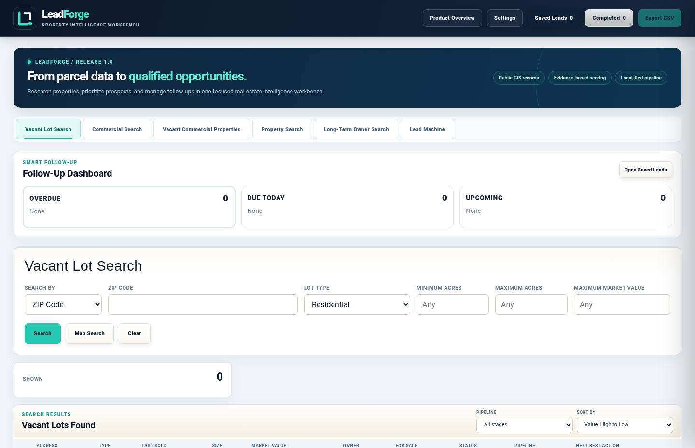

<div align="center">
  

  # LeadForge
  **Real estate intelligence workbench · Windows · v1.0**

  A local-first application for turning public parcel data and user-reviewed lead research into actionable, traceable prospecting workflows.
</div>



*Interface preview with empty local data. Live property results depend on public-source availability.*

## Why this project exists

Public property datasets are fragmented, hard to filter, and often ambiguous. LeadForge connects permitted GIS searches to normalized property records, transparent scoring, geographic filtering, a human-managed pipeline, and follow-up reminders. It prioritizes verifiable data over invented certainty.

## Highlights

| Area | Implementation |
|---|---|
| Property intelligence | Public ArcGIS REST parcel queries, vacant-lot / improved-commercial / long-term-owner screening, address lookup, maps |
| Decision support | Interpretable, rule-based opportunity scores and **vacancy signal estimates**, each with supporting rationale |
| Lead Machine | Six DFW-region ChatGPT research prompts for Reddit discovery; validated JSON import, review queue, canonical post ID deduplication |
| Workflow | Saved leads, Completed archive, pipeline stages, next-best-action guidance, follow-up planning, CSV export |
| Reliability | Bounded result rendering, request caching, visible storage errors, source limitations, regression tests |
| Privacy | Local browser storage, no embedded third-party credentials, configurable outreach signature; no automatic messages |

> **AI disclosure:** LeadForge is *AI-assisted*, not a self-running AI agent. Community discovery relies on a user operating ChatGPT and importing results. Scores and recommendations are transparent heuristics, **not model inference**. Parcel/vacancy data may be incomplete or stale. No automatic scraping or outreach occurs.

## Run from source on Windows

Requires Windows PowerShell and a modern browser. Live searches and maps require internet access. This portfolio snapshot includes the source and a dashboard preview. See the [case study](docs/PORTFOLIO_CASE_STUDY.md) for a walkthrough.


```powershell
# From the extracted source folder, Windows PowerShell:
.\START_APP.bat
```

Then open `http://127.0.0.1:8765/`. `server.ps1` supplies local HTTP and proxies supported public GIS requests; `app.js` implements UI/orchestration, with smaller independent modules for Reddit normalization and browser storage.

### Tests

```powershell
node --test tests/reddit-engine.test.cjs
node tests/import-integration.cjs
node tests/storage-migration.test.cjs
node tests/leadforge-branding.test.cjs
python tests/release_static_check.py
```

Build Windows binaries using Go (standard library only) and the supplied `build_release.ps1`. See `PACKAGING.md`.  GitHub Actions runs automated tests and security checks. Windows installers are built separately using the supplied build_release.ps1 script.

## Engineering documents

- [Architecture](ARCHITECTURE.md) — components, data flow, trust boundaries and persistence
- [Project spec](PROJECT_SPEC.md) — feature contract, scoring and validation caveats
- [Test plan](TEST_PLAN.md) — regressions and Windows verification gates
- [Roadmap](ROADMAP.md) — honest next improvements
- [Changelog](CHANGELOG.md) — release history
- [Case study](docs/PORTFOLIO_CASE_STUDY.md) — technical decisions and lessons

## External data and use restrictions

Live searches send query details to public GIS or geocoding providers. Map views request third-party tiles. Opening external lookup links can send owner names, parcel IDs, or addresses to the destination.

LeadForge queries publicly exposed GIS endpoints. Third-party availability, terms and attribution remain the responsibility of users and maintainers. Some DFW regions have partial or no coverage. Reddit's content is not automatically collected by the software. The app does not provide MLS listing verification, verified occupancy or confirmed owner contact details. Always validate against original sources and comply with applicable laws and platform rules.

## Security & contributions

See [SECURITY.md](SECURITY.md). No application secrets or real leads belong in issues, source commits or screenshots. The sample code is licensed under [MIT](LICENSE) and does not grant rights to third-party services, maps, data or trademarks.

